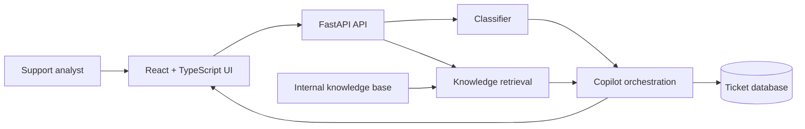

# SignalDesk AI

AI-assisted technical support triage and troubleshooting with evidence-backed recommendations.

## Why this project exists
SignalDesk AI demonstrates a production-style support workflow instead of a generic chatbot. A user submits a technical issue, the service classifies the incident, retrieves relevant internal knowledge, generates grounded troubleshooting steps, cites the supporting documentation, and records the analysis for later review.

## Portfolio highlights
- Full-stack React + TypeScript + FastAPI application
- Evidence-backed retrieval with visible source citations
- Ticket classification, severity scoring, escalation logic, and confidence scoring
- SQL persistence with SQLite locally and PostgreSQL support through `DATABASE_URL`
- Dockerized frontend/backend and CI test workflow
- Human-in-the-loop design: recommendations are suggestions, not autonomous actions

## Architecture


## Core workflow
1. Submit an issue such as: `Dockerized API returns connection refused when connecting to Postgres.`
2. SignalDesk classifies the ticket and estimates severity.
3. The retrieval engine ranks internal knowledge articles.
4. The copilot returns troubleshooting steps with citations.
5. Low-confidence or high-severity issues are flagged for escalation.
6. The ticket and analysis are stored for review.

## Run locally
### Backend
```bash
cd backend
python -m venv .venv
source .venv/bin/activate
pip install -r requirements.txt
uvicorn app.main:app --reload
```

### Frontend
```bash
cd frontend
npm install
npm run dev
```

Open `http://localhost:5173`.

## Run with Docker
```bash
docker compose up --build
```

## API endpoints
- `GET /api/health`
- `GET /api/knowledge`
- `POST /api/analyze`
- `GET /api/tickets`

## Example request
```json
{
  "title": "API cannot reach database",
  "description": "The service works locally, but after Docker deployment it returns connection refused when connecting to Postgres."
}
```

## What I would add next
- Vector database / embedding-based retrieval
- Pluggable LLM provider with structured-output validation
- Evaluation set for groundedness and citation accuracy
- Authentication + RBAC for support analysts and administrators
- Streaming responses and analyst feedback loop
- Cloud deployment, metrics, tracing, and alerting

## Resume-ready description
**SignalDesk AI — AI Technical Support Copilot**  
React • TypeScript • FastAPI • SQL • Docker • Retrieval
- Built an evidence-backed support copilot that classifies incidents, retrieves relevant knowledge, and produces cited troubleshooting recommendations.
- Implemented severity/confidence scoring and escalation logic to keep low-confidence or high-risk cases in a human review workflow.
- Containerized the frontend and API and added automated backend tests through GitHub Actions.
